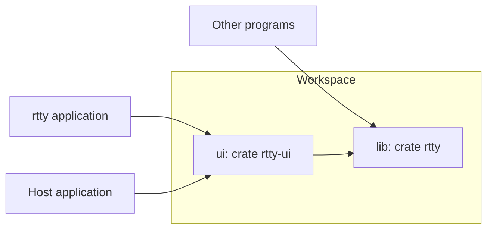
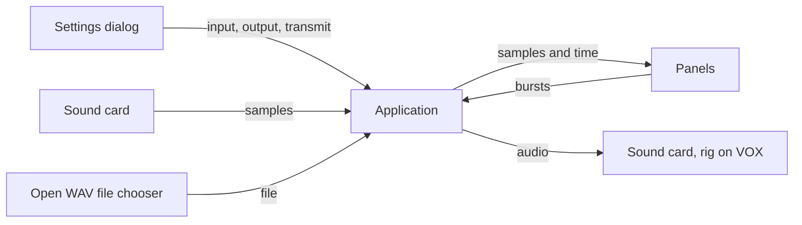
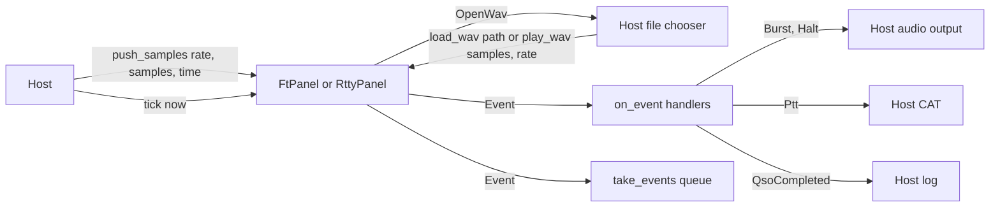
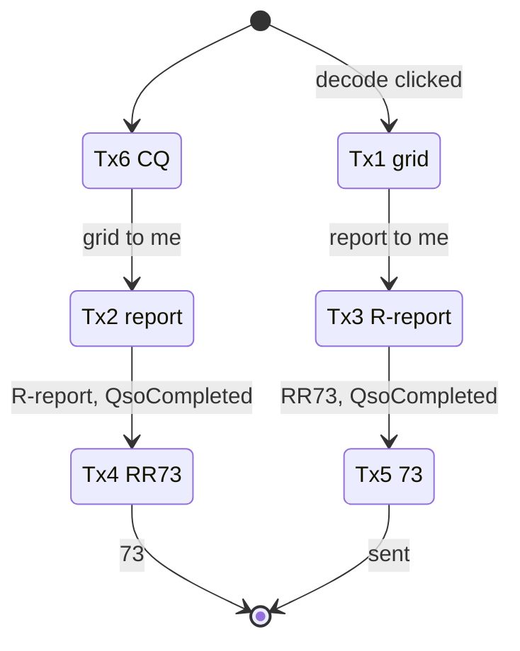
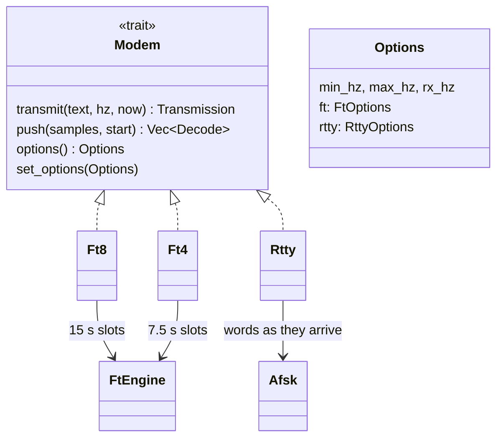
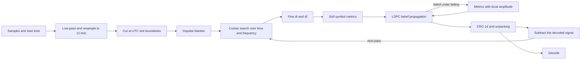
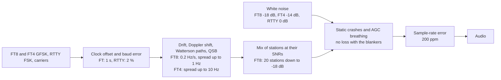
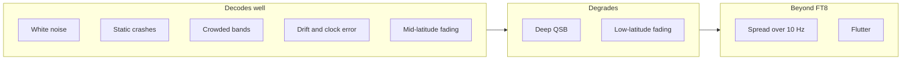
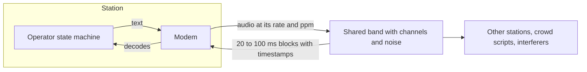

```mermaid
flowchart LR
  A[Text] --> B[Baudot with letters and figures shifts]
  B --> C[AFSK with 1.5 stop bits]
  C --> K[Impulse blanker]
  K --> D[Mark and space filters]
  D --> T[Automatic threshold correction]
  T --> E[Start bit check and bit timing]
  E --> S[Squelch on contrast and carrier]
  S --> F[Baudot decoder]
  F --> G[Words with timestamps]
```

# RTTY


RTTY is a Rust library for the FSK digital modes FT8, FT4 and RTTY, with an HF band simulator to test and tune them.
It comes with egui panels and an application.

## Workspace



| Directory | Crate | Role |
|---|---|---|
| `lib` | `rtty` | Modems, simulator and bench, pure Rust without I/O. |
| `ui` | `rtty-ui` | FT and RTTY panels, the auto-sequencer and the `rtty` application (feature `app`). |

## Get Started

```toml
[dependencies]
rtty = { git = "https://github.com/nextzlog/rtty" }
```

```rust
use rtty::{Ft8, Modem, Options};
use std::time::SystemTime;

let mut modem: Box<dyn Modem> = Box::new(Ft8::new(48000, Options::default())?);
let samples = vec![0.0; 960];
for d in modem.push(&samples, SystemTime::now()) {
    println!("{:?} {:+.0} dB {:?} {:.0} Hz {}", d.slot, d.snr, d.dt, d.hz, d.text);
}
let tx = modem.transmit("CQ JA1ZLO PM95", 1500.0, SystemTime::now())?;
println!("{} samples at {:?}", tx.audio.len(), tx.start);
Ok::<(), String>(())
```

## Build

```sh
$ cargo build --release -p rtty-ui
$ ./target/release/rtty
$ cargo test --workspace
```

## Application

The application shows the FT8 and FT4 panel and the RTTY panel in tabs.



| Setting | Choice |
|---|---|
| Input | Default or a sound card |
| Output | Default or a sound card |
| Transmit | Off, or VOX |

Open WAV plays a chosen file into the decoder in real time, in place of the sound card, until it ends or Stop WAV is pressed.
An FT file is taken to start at a slot boundary, as WSJT-X saves it.
CAT is left to host applications.

## Panels

A host shows the same panels in its own windows.

```toml
rtty-ui = { git = "https://github.com/nextzlog/rtty", default-features = false }
```



| Item | Role |
|---|---|
| `FtPanel` | Toolbar, decode list, band strip, DX row and Tx1 to Tx6 with the auto-sequencer. |
| `RttyPanel` | Toolbar with message buttons, terminal, heard callsigns and the text to send. |
| `toolbar`, `body`, `ui` | The toolbar row, the rest, or both. |
| `settings_ui` | Options for the host's settings dialog. |
| `settings`, `load_setting` | Key and value pairs to persist. |
| `FtTools`, `RttyTools` | Toolbar items a host hides. |
| `Message` | Label and text of a message button. |
| `Clock` | Times of sample blocks from a sound card. |
| `load_wav`, `play_wav`, `stop_wav` | A WAV file played into the decoder in real time. |
| `wav::read`, `wav::write` | Mono samples and rate of a WAV file. |

| Toolbar | Items |
|---|---|
| FT | Start, FT8, FT4, Even, Odd, Enable Tx, Halt, Open WAV |
| RTTY | Start, message buttons, Open WAV |

Devices are chosen only in settings dialogs, and the toolbar wraps down to 280 px.

### Events

| Event | Fields | Meaning |
|---|---|---|
| `Running` | bool | Receiving started or stopped. |
| `Decode` | `rtty::Decode` | An FT message or an RTTY word. |
| `Pick` | callsign, grid, hz | A clicked decode or callsign. |
| `Heard` | callsign, report, exchange | An RTTY line read at its end. |
| `Number` | text | The number after 599 in RTTY. |
| `Message` | index, text | A clicked message button. |
| `QsoCompleted` | mode, callsign, grid, sent, rcvd, hz, at | A contact completed by the auto-sequencer. |
| `Burst` | at, rate, samples | Audio to play from the time at. |
| `Halt` | | Stop the audio. |
| `Ptt` | bool | Key or unkey the transmitter. |
| `OpenWav` | | Open WAV was pressed, so the host chooses a file. |

```rust,ignore
panel.on_event(|e| if let rtty_ui::Event::QsoCompleted(q) = e { println!("{} {}", q.callsign, q.rcvd) });
```

With `host_sends` set, a message button only reports `Message`, and the host expands the text and calls `send`.
With `host_call` set, the host fills `my_call` and `settings_ui` leaves it out.
`typed` and `send_typed` give a host the text in the send field, for its own Send command.

### Auto-Sequencer



A clicked decode also sets Rx to its frequency and Tx to the other slot.
The burst goes out 0.5 s into the slot, and a slot missed by more than 1 s waits for the next.

## Modes

All three modes implement one trait, so an application can hold any of them as a `Box<dyn Modem>`.



| Decode | FT8 and FT4 | RTTY |
|---|---|---|
| slot | UTC start of the slot | None |
| at | End of the slot | Time of the last character |
| snr | SNR in 2500 Hz | Estimate from the tone contrast |
| hz | Frequency of tone 0 | Lower tone, the frequency for `rx_hz` and `transmit` |
| dt | Offset from the nominal 0.5 s | None |
| text | Message | One word, split after 64 characters, or `\n` |
| unit | `Message` | `Word` or `LineBreak` |
| fields | Addressee, sender and exchange | None |

A `Transmission` holds the audio, its start time and the slot parity.
FT audio starts 0.5 s into the next slot, and RTTY audio starts at once.
Any sample rate from 8 kHz up is accepted, block sizes are free, and timestamps may jitter by up to 20 ms.

## Receiving FT8 and FT4



Standard messages, grids, reports, RRR, RR73, 73 and free text are supported.
Hashed and non-standard callsigns and the contest message types are not supported yet.

## RTTY



`RttyOptions` sets the mark tone, shift, speed, reverse, unshift on space, squelch, ATC and blanker.

## Simulator

The simulator renders band audio deterministically from a seed.



Each box notes what the decoders tolerate at that stage.

| Preset | Doppler spread | Delay |
|---|---|---|
| mid-quiet | 0.1 Hz | 0.5 ms |
| mid-moderate | 0.5 Hz | 1 ms |
| mid-disturbed | 1 Hz | 2 ms |
| low-moderate | 1.5 Hz | 2 ms |
| low-disturbed | 10 Hz | 6 ms |
| high-moderate | 10 Hz | 3 ms |
| high-disturbed | 30 Hz | 7 ms |
| flutter | 20 Hz | 2 ms |

## Performance

All figures come from the simulator, with SNR in 2500 Hz.

| Item | FT8 | FT4 | RTTY |
|---|---|---|---|
| Slot or speed | 15 s | 7.5 s | 45.45 Bd, configurable |
| Tones | 8, 6.25 Hz apart | 4, 20.8 Hz apart | 2, 170 Hz shift, configurable |
| Sample rate | 8 to 384 kHz | 8 to 384 kHz | 8 to 384 kHz |
| Decode time | 220 ms per slot, 310 ms with 20 stations | 250 ms per slot | 23 ms per 21 s of audio |
| All decoded in white noise | -18 dB | -14 dB | 0.4 % errors at 0 dB |
| Errors in white noise | | | 0.4 % at -2 dB, 7 % at -4 dB, 36 % at -6 dB |
| Crowded slot of 20 stations | all down to -18 dB | 98 % at -14 dB | |
| Neighbours | 2 stations 20 Hz apart are separated | | 300 to 450 Hz away is harmless |
| Drift | 0.2 Hz/s down to -18 dB | | |
| Clock and rate error | 1 s and 200 ppm down to -18 dB | | 2 % baud error |
| False decodes on an empty band | 0 | 0 | 0 per minute |



FT8 cannot follow a Doppler spread wider than its 6.25 Hz tone spacing.
FT4, with 20.8 Hz spacing, still decodes some of it.

FT columns show the lowest SNR in 2500 Hz where half the signals decode, and RTTY columns show character errors at 10 dB, without and with the blankers, the fading metric and the ATC.

| Channel | FT8 | FT4 | RTTY |
|---|---|---|---|
| awgn | -18 / -18 dB | -14 / -14 dB | 0 / 0 % |
| static crashes | -8 / -18 dB | none / -14 dB | 15 / 0 % |
| mid-quiet | -14 / -16 dB | -16 / -16 dB | 8 / 5 % |
| mid-moderate | -16 / -16 dB | -12 / -12 dB | 13 / 7 % |
| mid-disturbed | -16 / -16 dB | -10 / -10 dB | 23 / 15 % |
| low-moderate | -16 / -16 dB | -12 / -12 dB | 29 / 16 % |
| low-disturbed | -8 / -8 dB | -10 / -10 dB | 24 / 27 % |
| high-moderate | none | -10 / -10 dB | 38 / 35 % |
| high-disturbed | none | none | 47 / 50 % |
| flutter | none | -4 / -4 dB | 32 / 33 % |

## Bench

```sh
$ cargo run --release -p rtty --example bench -- ft8 mid-moderate 20
$ cargo run --release -p rtty --example bench -- rtty all 10 plain
$ cargo run --release -p rtty --example bench -- ft4 silence 30
```

| Mode | Sweep |
|---|---|
| preset name | Decodes or character errors against SNR through that channel |
| all | Every preset and static crashes |
| qrn | Static crashes on white noise |
| crowd | Twenty FT stations in one slot |
| silence | False decodes per hour, or false characters per minute against the RTTY squelch, on empty bands |

`plain` turns off the blankers, the fading metric and the ATC, for comparison.

## Silence

An empty band must stay empty.

| Band | FT8 and FT4 | RTTY at squelch 0.55 |
|---|---|---|
| White noise | 0 per hour | 0 per minute |
| Static crashes | 0 per hour | 0 per minute |
| AGC breathing | 0 per hour | 0 per minute |
| Carriers and crashes | 0 per hour | 0 per minute |

| RTTY squelch | 0.45 | 0.50 | 0.55 | 0.60 | 0.65 |
|---|---|---|---|---|---|
| False characters per minute | 0.5 | 0.1 | 0 | 0 | 0 |
| Character errors at 0 dB | 0.4 % | 0.4 % | 0.4 % | 1.6 % | 8.3 % |

## QSO Tests

The tests run whole contacts on a shared band.



Each operator chooses its next message from the decoded fields only.
Stations have their own clocks, sound-card errors, sample rates and channels, and a receiver is muted while it transmits.
The scenarios cover full FT8 and FT4 contacts, an FT4 contest, a crowded band, a pile-up, weak signals, fading, drift, clock offsets, lost messages, the hour boundary and RTTY contest exchanges.

## License

### Author

- JG1VPP
- JS2FVO

### Clauses

- This library is released under the [MIT License](LICENSE).
- The LDPC tables in `src/tables.rs` are taken from [ft8_lib](https://github.com/kgoba/ft8_lib) by Kārlis Goba, also under the MIT License.
