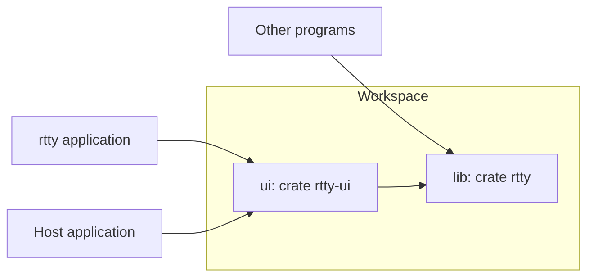
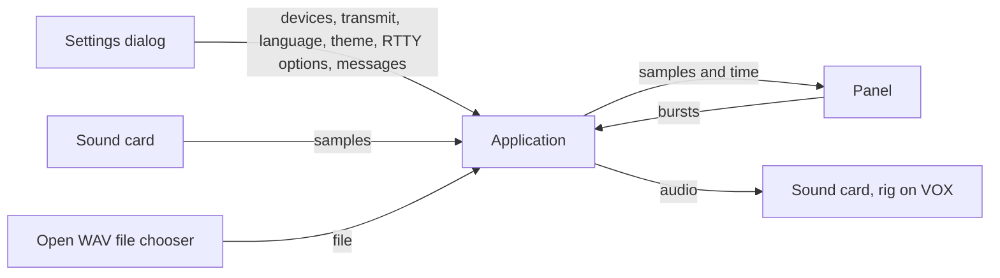
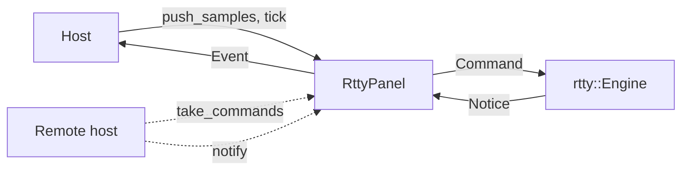
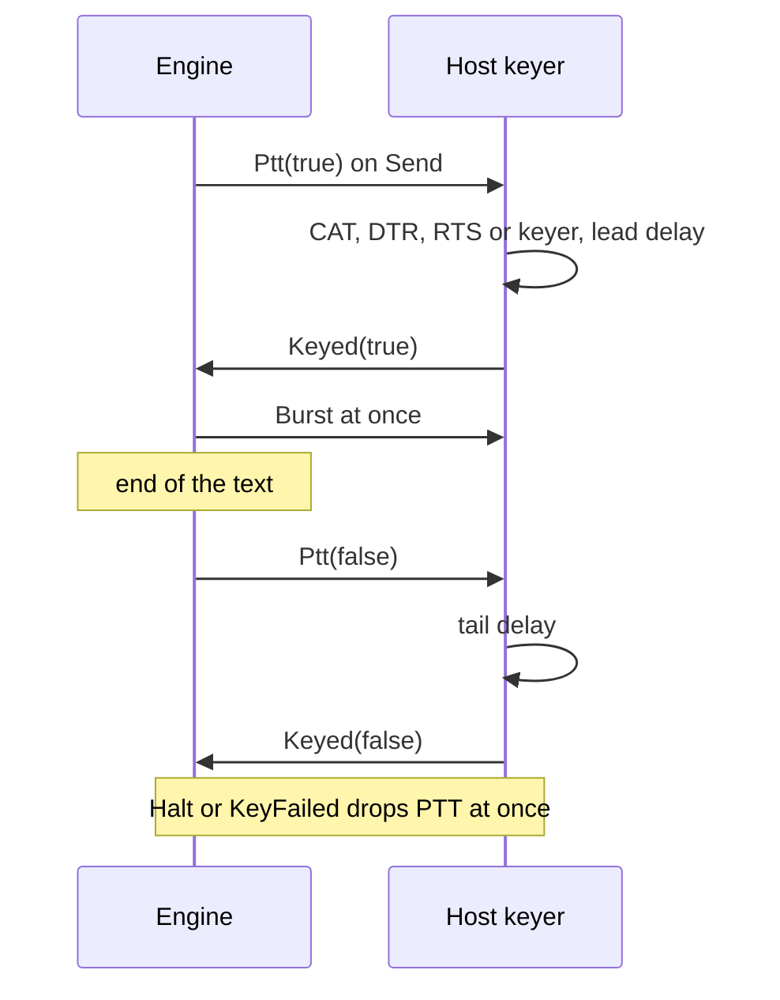
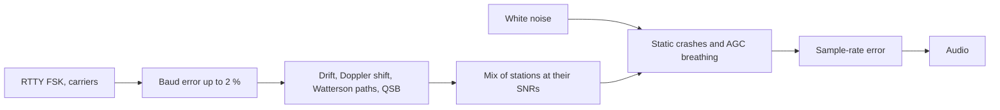

# RTTY


RTTY is a Rust library for radioteletype, with an HF band simulator to test and tune it.
It comes with an egui panel and an application.
FT8 and FT4 live in the sister library [FTxL](https://github.com/nextzlog/ftxl).

## Workspace



| Directory | Crate | Role |
|---|---|---|
| `lib` | `rtty` | Baudot, AFSK modem, engine, simulator and bench, pure Rust without I/O. |
| `ui` | `rtty-ui` | RTTY panel and the `rtty` application (feature `app`). |

## Get Started

```toml
[dependencies]
rtty = { git = "https://github.com/nextzlog/rtty" }
```

```rust
use rtty::{Modem, Options, Rtty};
use std::time::SystemTime;

let mut modem = Rtty::new(48000, Options::default())?;
let tx = modem.transmit("CQ TEST JA1ZLO", 2125.0, SystemTime::now())?;
for d in modem.push(&tx.audio, tx.start) {
    println!("{:?} {:+.0} dB {:.0} Hz {}", d.unit, d.snr, d.hz, d.text);
}
Ok::<(), String>(())
```

## Build

```sh
$ cargo build --release -p rtty-ui
$ ./target/release/rtty
$ cargo test --workspace
```

## Application



```text
+----------------------------------------------------------+
| ▶ Start  🗁 Open…  ⇄ CQ  CQ Call 599 TU QRZ AGN  ⚙ Settings |
+----------------------------------------------------------+
| terminal, full width                                     |
+----------------------------------------------------------+
| JA1ZLO  JH1ABC  JR1XYZ                                   |
| [Text to send                           ]  Send  Halt    |
+----------------------------------------------------------+
```

| Setting | Choice |
|---|---|
| Input, Output | Default device or a sound card |
| Transmit | Off, or VOX |
| Language | English or 日本語 |
| Theme | System, Light or Dark |
| RTTY | My call, mark, shift, baud, squelch, flags, PTT delays, highlight |
| CQ messages, S&P messages | Labels and texts of the two message banks |

`⇄` switches the message buttons between the CQ bank and the S&P bank.
Open WAV plays a chosen file into the decoder in real time, in place of the sound card.
CAT is left to host applications.

## Panel and Engine

The panel never touches the modem.
It sends a `Command` to an `Engine` and shows the `Notice`s that come back, so a host may run the engine on another machine.



| Command | Meaning |
|---|---|
| `Start`, `Stop` | Receive or not. |
| `Options`, `Timing` | Modem options and PTT delays. |
| `Send` | Text to transmit, with the time. |
| `Halt` | Abort the transmission. |
| `Samples` | Audio with its rate and start time. |
| `OutputRate` | Sample rate of the audio output. |
| `Tick` | The current time. |
| `PttLead` | A host keyer attached, or `None` without one. |
| `Keyed`, `KeyFailed` | The host keyer confirms keying or release, or reports a failure. |
| `Dial` | The dial frequency in Hz. |

| Notice | Meaning |
|---|---|
| `Running` | Receiving started or stopped. |
| `Decode` | A word or a line break. |
| `Busy` | The sender is busy or idle. |
| `Burst`, `Halt`, `Ptt` | Audio to play, stop the audio, key the transmitter. |
| `Dial` | The dial frequency, stamped on picks and heard lines. |
| `Error` | A message for the status line. |

## Keying



With a host keyer, the delays of `Timing` are the host's, and the sender stays busy until `Keyed(false)`.
Text sent during the tail keys again after it.
Without `PttLead`, the engine keeps its own delays from `Timing`, as the standalone application does on VOX.

`RttyPanel::new` holds its own engine.
`RttyPanel::remote` holds none, and the host carries `take_commands` to the engine and its notices back to `notify`.

| Item | Role |
|---|---|
| `RttyPanel` | Toolbar, a full-width terminal, heard callsigns and the text to send. |
| `toolbar`, `body`, `ui`, `tools_ui`, `toolbar_ui` | The toolbar row, the rest, or both, with host items after Open WAV. |
| `settings_ui`, `settings`, `load_setting` | Panel options and their key and value pairs. |
| `messages`, `sp_messages`, `bank` | The CQ bank, the S&P bank and the shown one. |
| `RttyTools` | Toolbar items a host hides. |
| `host_sends`, `host_call` | The host expands messages and calls `send`, or fills `my_call`. |
| `set_ptt_lead`, `keyed`, `key_failed`, `set_dial` | The host keyer and the dial. |
| `Clock`, `wav` | Times of sound-card blocks, and WAV files. |

| Event | Fields | Meaning |
|---|---|---|
| `Running` | bool | Receiving started or stopped. |
| `Decode` | `rtty::Decode` | A word or a line break. |
| `Pick` | callsign, hz, dial_hz | A clicked callsign. |
| `Heard` | callsign, report, exchange, dial_hz | A line read at its end. |
| `Number` | text | The number after 599. |
| `Message` | bank, index, text | A clicked message button. |
| `Burst`, `Halt`, `Ptt` | | Audio, stop, key. |
| `OpenWav`, `Settings` | | The host opens a file or its settings. |

The icons are the Phosphor font in `ui/data`, drawn by `rtty_ui::icon`.
The toolbar wraps down to 280 px, and the panel fills a tall narrow dock.

## Modem

```mermaid
flowchart LR
  A[Text] --> B[Baudot with letters and figures shifts]
  B --> C[AFSK with 1.5 stop bits]
  C --> K[Impulse blanker]
  K --> D[Mark and space filters]
  D --> T[Automatic threshold correction]
  T --> E[Start bit check and bit timing]
  E --> S[Squelch on contrast and carrier]
  S --> F[Baudot decoder]
  F --> G[Words with timestamps]
```



| Decode | Meaning |
|---|---|
| at | Time of the last character |
| snr | Estimate from the tone contrast |
| hz | Lower tone, the frequency for `rx_hz` and `transmit` |
| text | One word, split after 64 characters, or `\n` |
| unit | `Word` or `LineBreak` |

`RttyOptions` sets the mark tone, shift, speed, reverse, unshift on space, squelch, ATC and blanker.
Any sample rate from 8 kHz up is accepted, block sizes are free, and timestamps may jitter by up to 20 ms.

## Simulator



| Preset | Doppler spread | Delay | Character errors at 10 dB |
|---|---|---|---|
| awgn | | | 0 / 0 % |
| mid-quiet | 0.1 Hz | 0.5 ms | 6 / 5 % |
| mid-moderate | 0.5 Hz | 1 ms | 11 / 7 % |
| mid-disturbed | 1 Hz | 2 ms | 27 / 15 % |
| low-moderate | 1.5 Hz | 2 ms | 30 / 20 % |
| low-disturbed | 10 Hz | 6 ms | 25 / 28 % |
| high-moderate | 10 Hz | 3 ms | 40 / 39 % |
| high-disturbed | 30 Hz | 7 ms | 44 / 49 % |
| flutter | 20 Hz | 2 ms | 32 / 33 % |

Errors are without and with the blankers and the ATC.
In white noise, errors are 0 % at 0 dB, 15 % at -4 dB and 53 % at -6 dB, and a neighbour 300 to 450 Hz away is harmless.

```sh
$ cargo run --release -p rtty --example bench -- mid-moderate 20
$ cargo run --release -p rtty --example bench -- all 10 plain
$ cargo run --release -p rtty --example bench -- silence 30
```

| RTTY squelch | 0.45 | 0.50 | 0.55 | 0.60 | 0.65 |
|---|---|---|---|---|---|
| False characters per minute | 0.4 | 0.1 | 0 | 0 | 0 |
| Character errors at 0 dB | 0.4 % | 0.4 % | 0.4 % | 1.6 % | 8.3 % |

## QSO Tests


The scenarios cover contest exchanges, fading at 48 kHz, a neighbouring signal, reversed shift and flutter.

## License

### Author

- JG1VPP
- JS2FVO

### Clauses

- This library is released under the [MIT License](LICENSE).
- The Phosphor Icons is under the [MIT License](ui/data/LICENSE).
